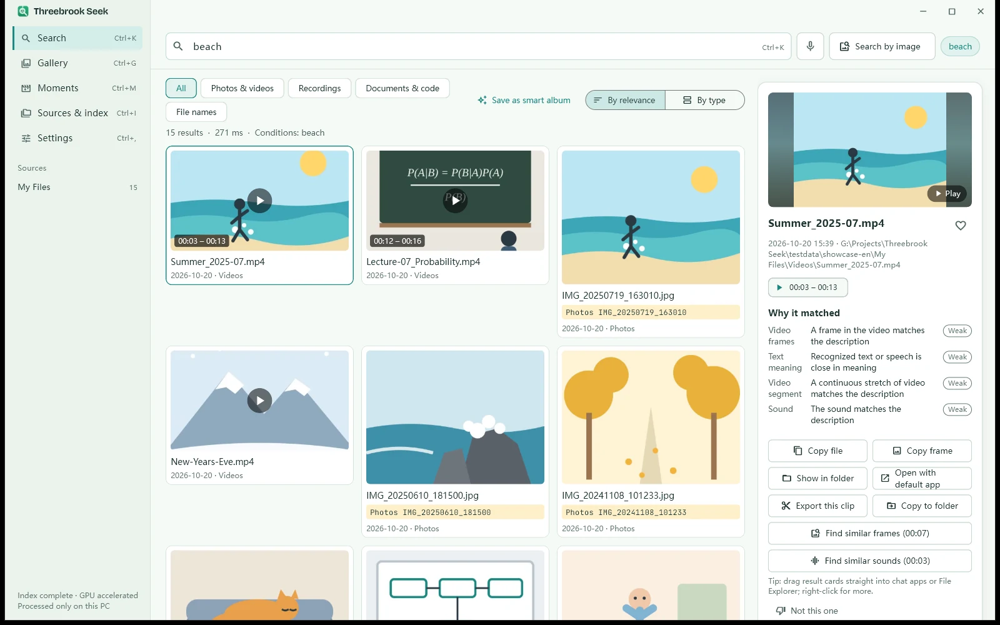
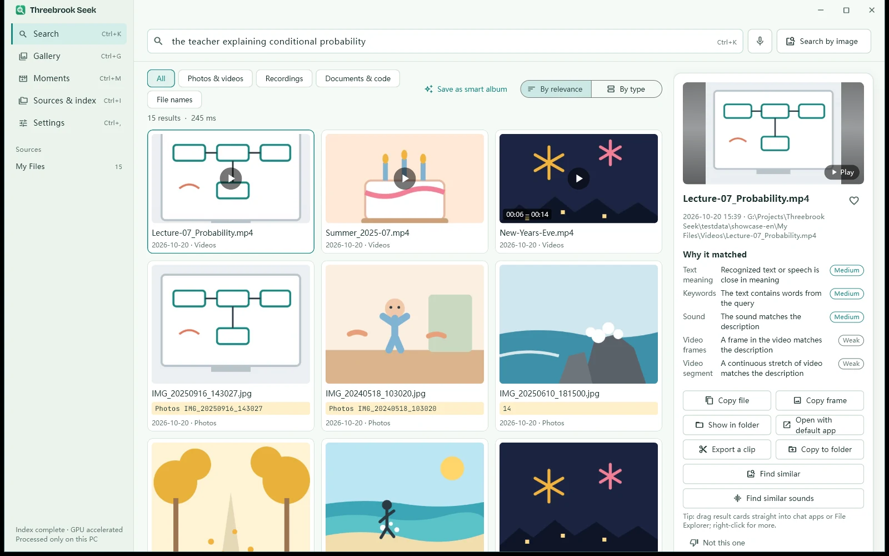
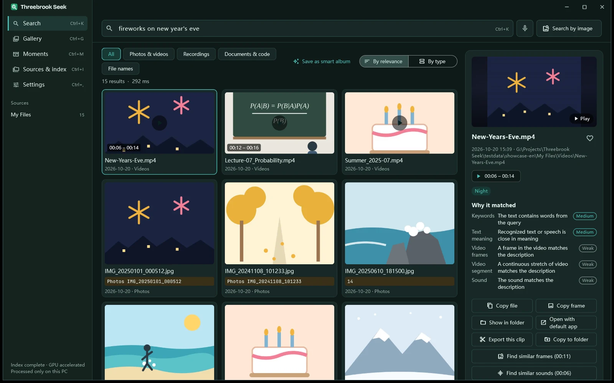

<h1>Threebrook Seek</h1>

<h3>Pictures, sounds, words. One sentence finds them all.</h3>

AI search that runs on your own PC. Describe something the way you remember it, and jump straight to the photo, the seconds in a video, the line in a recording, the page in a document.

  

   

[Features](#one-sentence-straight-to-it) · [Download](#download) · [Personal and Pro](#personal-and-pro) · [FAQ](#faq) · [Discussions](https://github.com/ThreeBrook/ThreeBrook-Seek/discussions) · [中文](README.md) | **English**

## One sentence, straight to it

No file names to remember, no sorting or tagging first. Describe what you remember, the way you’d tell a friend:

<table>
<tr>
<td width="50%"></td>
<td width="50%"></td>
</tr>
<tr>
<td><b>🔊 Search what was said</b> “The teacher explaining conditional probability” — speech in recordings and videos is transcribed, so playback starts right at that sentence.</td>
<td><b>🎆 Search what you saw</b> “Fireworks on New Year’s Eve” — photos and video frames are matched by what’s in them, light or dark theme.</td>
</tr>
<tr>
<td></td>
<td></td>
</tr>
<tr>
<td><b>🎬 Straight to the seconds</b> Videos are indexed segment by segment. The matching stretch lights up on the timeline, usually to within a few seconds.</td>
<td><b>🔍 Text in photos counts</b> Screenshots, whiteboards, receipts, part numbers on a circuit board — found, boxed, and ready to copy.</td>
</tr>
</table>

### Three brooks, one search box

Threebrook is named after the three brooks that meet in the middle of our town. Threebrook Seek brings three kinds of things in your files together in one search box:

| 🖼️ Pictures | 🔊 Sounds | 📄 Words |
| --- | --- | --- |
| Photos, video frames, and pages of PDFs and slide decks — found by what you saw, with no file names to remember and no tagging first. | Speech in recordings and videos is transcribed, and it also recognizes applause, laughter, waves, fireworks and more. | Word, Excel, PDF, web pages, e-books and email, plus the text inside screenshots and photos — matched by meaning, not just the same words. |

<b>Supported files</b>

| Type | Formats |
| --- | --- |
| Photos | JPG, PNG, HEIC / HEIF, WebP, AVIF, GIF, BMP, TIFF, camera RAW (DNG, CR2, CR3, NEF, ARW, RAF, ORF, RW2) |
| Videos | MP4, MOV, MKV, AVI, WMV, M4V, WebM, 3GP, MTS / M2TS, MPG, FLV, RMVB and more |
| Recordings | MP3, WAV, M4A, AAC, FLAC, OGG, Opus, WMA, AMR, APE and more |
| Documents | PDF, Word (DOCX), PowerPoint (PPTX), Excel (XLSX), CSV, TXT / Markdown, web pages, EPUB, RTF, ODF, email (EML / MSG), subtitles, Jupyter notebooks |
| Pro adds | Code and project files by content; legacy DOC / PPT / XLS and WPS files (converted with Office or WPS on your PC) |

### More than search

| | |
| --- | --- |
| 🖼️ **Search by image or sound** | Drop in a picture, paste a screenshot or pick a sound clip to find similar photos, video frames and recordings. |
| ⚡ **Quick search bar** | Call it up anywhere with a shortcut. File-name search covers every drive, with results as you type. |
| 📅 **Gallery, Moments, smart albums** | Browse by date; trips and get-togethers are grouped into Moments automatically; save any search as a self-updating album; On This Day. |
| 🧹 **Duplicates and look-alikes** | Spot burst shots and copies at a glance, and decide which to keep. |
| 🔒 **Private folders** | Unlocked with Windows Hello; otherwise hidden from search and the gallery. |
| ✂️ **After you find it** | Drag results into chat apps or File Explorer; copy the image or a video frame; export a clip; select text in photos and recordings. |
| 🌗 **Chinese and English, light and dark** | Switch the interface language anytime; follows your system theme. |
| 🐾 **Tuanzi** | A little desktop companion that helps you look for things (you can turn it off). |

### Your files stay on your PC

- **Nothing uploaded.** The AI models are installed with the app. Indexing and search happen on your PC, and it works offline.
- **Nothing collected.** No analytics, no ads, no account. It goes online only when you confirm “Check for updates” on the About page, which reads a version file from our website, and when you then click “Download & install” for a new version. None of your data is sent.
- **Stored encrypted.** The index, thumbnails and recognized text are encrypted, and only your Windows user on this PC can open them.
- **Sensitive features off by default.** Face grouping and place lookup are turned on only with your separate consent.
- **Your originals untouched.** Files are only read — never moved, changed or renamed.

## Download

Latest version **0.6.6** · [What’s new](CHANGELOG.md) · [All releases](https://github.com/ThreeBrook/ThreeBrook-Seek/releases)

| | Download | Best for |
| --- | --- | --- |
| **Standard** recommended | [ThreebrookSeek-Setup-0.6.6.exe](https://github.com/ThreeBrook/ThreeBrook-Seek/releases/download/v0.6.6/ThreebrookSeek-Setup-0.6.6.exe) (686 MB) | Any Windows PC. One file: download and double-click. |
| **GPU** | [ThreebrookSeek-Setup-GPU-0.6.6.exe](https://github.com/ThreeBrook/ThreeBrook-Seek/releases/download/v0.6.6/ThreebrookSeek-Setup-GPU-0.6.6.exe) (1.9 GB) [ThreebrookSeek-Setup-GPU-0.6.6-2.bin](https://github.com/ThreeBrook/ThreeBrook-Seek/releases/download/v0.6.6/ThreebrookSeek-Setup-GPU-0.6.6-2.bin) (455 MB) | PCs with an NVIDIA graphics card; indexing is several times faster. **Download both files into the same folder**, then run the .exe. |

- **System:** Windows 10 / 11 (64-bit). About 1.2 GB (Standard) or 4 GB (GPU) once installed, plus the index.
- **Install:** no admin rights and no internet connection needed. If something goes wrong or you cancel halfway, it puts everything back the way it was.
- **Verify:** SHA-256 checksums for every version are on the [releases page](https://github.com/ThreeBrook/ThreeBrook-Seek/releases); check with `Get-FileHash <file>` in PowerShell. You can also download from the [website](https://seek.threebrook.com/en/download).

## Personal and Pro

| | Personal | Pro |
| --- | :---: | :---: |
| Price | **Free** | One-time purchase, no subscription |
| For | Home and personal non-commercial use | Work and commercial use |
| Files you can index | 50,000 | Unlimited |
| One-sentence search across photos, videos, recordings, documents | ✓ | ✓ |
| Search by image or sound, quick search bar, file-name search | ✓ | ✓ |
| Gallery, Moments, smart albums, people, private folders | ✓ | ✓ |
| NAS / network folders as sources | | ✓ |
| Meeting mode: recordings aligned with slides, draft minutes | | ✓ |
| Code and project files, legacy Office / WPS by content | | ✓ |
| Local MCP server (for AI assistants) | | ✓ |
| New versions | ✓ | Versions released within a year |

Every install starts with a **14-day Pro trial**. Activation and the trial both happen on your PC. [About Pro →](https://seek.threebrook.com/en/buy)

## FAQ

<b>Does it need the internet?</b>

No. Installing, indexing and searching all happen on your PC, and it works offline. It goes online only when you click “Check for updates” on the About page and confirm, which reads a version file from our website, and when you then click “Download & install” to get a new version.

<b>Does it work without a graphics card? How long does indexing take?</b>

Yes. On first launch it measures your PC and tells you how long until your photos are searchable by content, and how long until text in photos is done too. Indexing runs in the background — you can search at any time, and it picks up where it left off after a restart. With an NVIDIA card, the GPU edition is several times faster.

<b>Will it change or upload my photos? Where is the index kept?</b>

Neither. Threebrook Seek only reads the folders you choose. The index lives in `%LOCALAPPDATA%\ThreebrookSeek` by default (you can move it to another drive in Settings), and it’s all encrypted.

<b>Is the Personal edition time-limited?</b>

No. Personal is free for good, for home and personal non-commercial use, and indexes up to 50,000 files. For the first 14 days after installing you can try every Pro feature; after that it returns to Personal and keeps everything already indexed.

<b>External drives and NAS?</b>

External drives can be added as sources. You can still search them while they’re unplugged, indexing resumes when they’re back, and they’re recognized even with a new drive letter. NAS and network folders are a Pro feature.

<b>Is there a Mac or phone version?</b>

Windows only for now. If you’d like another platform, tell us in the [Discussions](https://github.com/ThreeBrook/ThreeBrook-Seek/discussions).

<b>How do I uninstall?</b>

Windows Settings → Apps → Threebrook Seek → Uninstall. You can tick “Also delete the index data”; if you don’t, it’s kept so a reinstall doesn’t need to index again. Your photos and documents themselves are not affected.

## Feedback and discussion

- 💬 **How-tos, ideas, suggestions** → [Discussions](https://github.com/ThreeBrook/ThreeBrook-Seek/discussions)
- 🐞 **Errors, crashes, things it can’t find** → [open an issue](https://github.com/ThreeBrook/ThreeBrook-Seek/issues/new) with your Windows version, the edition (Standard or GPU) and the steps that led to it. The log is at `%LOCALAPPDATA%\ThreebrookSeek\app.log` — please remove any file names or paths you don’t want to share before posting.
- ✉️ **Purchases, activation, refunds, or anything private** → support@threebrook.com

## About this repository

This is where Threebrook Seek’s installers and release notes are published, and where users talk to each other. The app’s source code is not public and is not here.

[Releases](https://github.com/ThreeBrook/ThreeBrook-Seek/releases) (installers and checksums) · [CHANGELOG.md](CHANGELOG.md) (what changed in each version) · [Website](https://seek.threebrook.com/en/)

---

<a href="https://threebrook.com/en/"><picture><source media="(prefers-color-scheme: dark)" srcset="https://threebrook.com/lockup-dark.svg"></picture></a>

**A small team from the town of Threebrook, making quiet, reliable software that runs on your own computer.**

| 🟢 Local first | 🌿 Nothing collected | ☀️ Small and reliable |
| :---: | :---: | :---: |
| If it can be done on your computer, it stays off the cloud | No analytics, no ads, no tracking — our websites included | Each product does one thing, well and steadily |

© 2026 Threebrook · Zhuhai Threebrook Technology Co., Ltd. · support@threebrook.com Use of the software is subject to the license agreement and privacy policy included with it.

