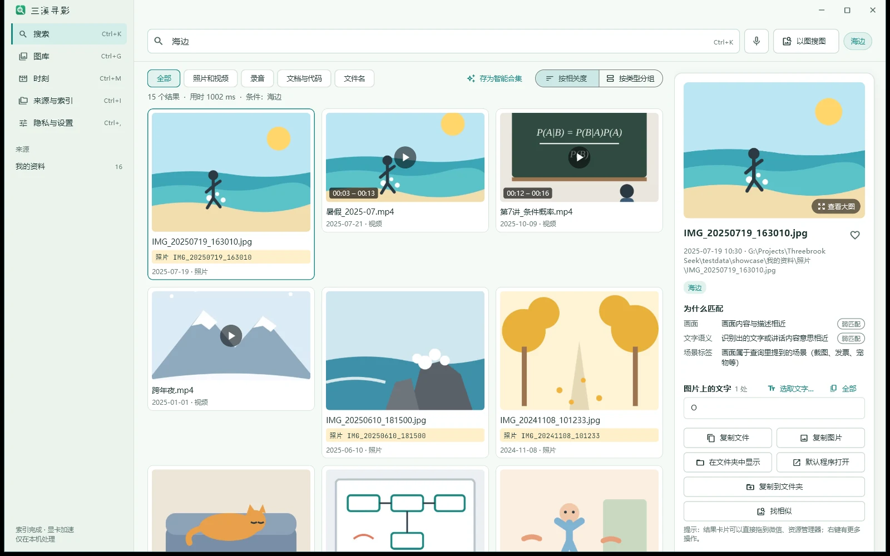
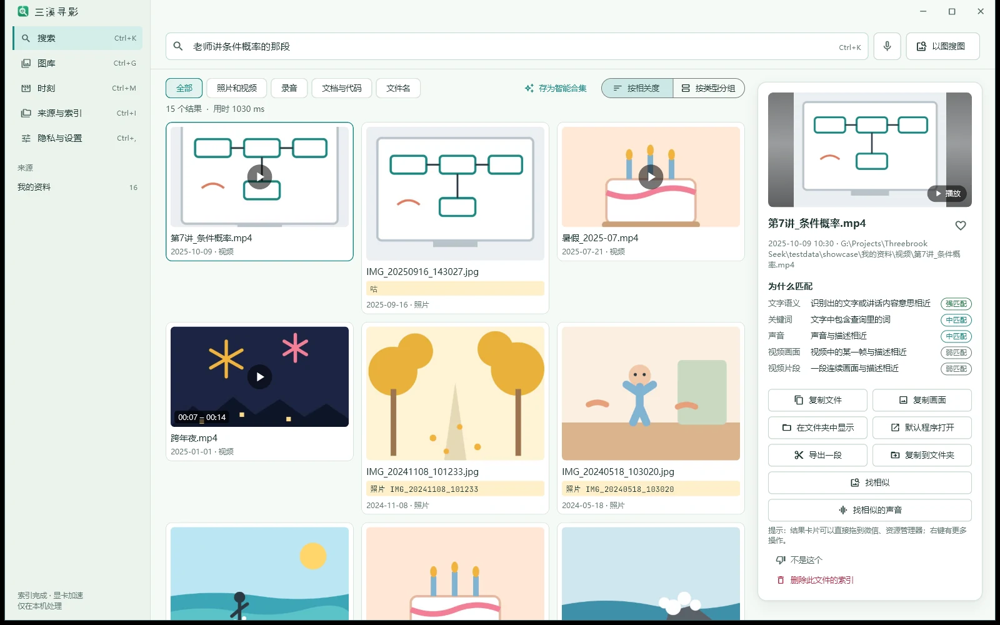
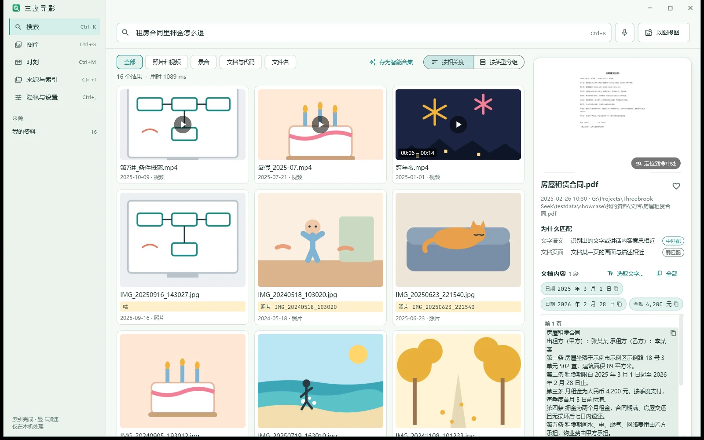
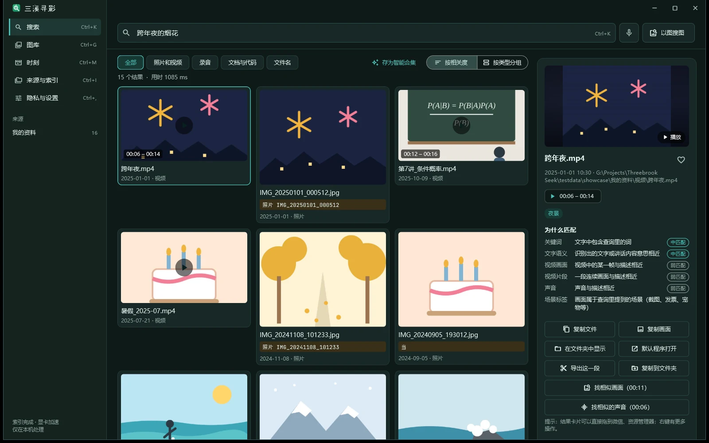

<h1>三溪寻影</h1>

<h3>画面、声音、文字，一句话都找得到。</h3>

在你自己电脑上运行的 AI 媒体搜索。照你记得的样子说一句话， 直接找到那张照片、视频里的那几秒、录音里的那句话、文档里的那一页。

  

   

[功能](#一句话直接找到) · [下载](#下载) · [个人版与专业版](#个人版与专业版) · [常见问题](#常见问题) · [讨论区](https://github.com/ThreeBrook/ThreeBrook-Seek/discussions) · **中文** | [English](README.en.md)

## 一句话，直接找到

不用记文件名，不用先整理、打标签。像跟人描述一样说出你记得的样子：

<table>
<tr>
<td width="50%"></td>
<td width="50%"></td>
</tr>
<tr>
<td><b>🔊 说过的话也能搜</b> “老师讲条件概率的那段”——录音和视频里的讲话会转成文字，点一下从那句话开始播。</td>
<td><b>📄 文档里的那一条</b> “租房合同里押金怎么退”——按意思找到合同，右边直接显示讲押金的条款。</td>
</tr>
<tr>
<td></td>
<td></td>
</tr>
<tr>
<td><b>🎬 直接跳到那几秒</b> 视频按片段建索引，进度条上亮起来的就是命中的那一段，通常精确到几秒。</td>
<td><b>🔍 照片里的字也算数</b> 截图、白板、票据、电路板上的型号和参数，都能搜到并框出来，还能直接复制。</td>
</tr>
</table>

### 三条溪，汇成一个搜索框

“三溪”是我们团队所在的小镇，镇上三条溪在中间汇到一起。三溪寻影把你资料里的三种东西汇到同一个搜索框里：

| 🖼️ 画面 | 🔊 声音 | 📄 文字 |
| --- | --- | --- |
| 照片、视频画面、PDF 和 PPT 的页面。按看到的内容找，不用记文件名，也不用先打标签。 | 录音和视频里说过的话会转成文字，掌声、笑声、海浪、烟花这些声音也认得。 | Word、Excel、PDF、网页、电子书、邮件，还有截图和照片里的字。意思相近也能找到。 |

<b>支持哪些文件</b>

| 类型 | 格式 |
| --- | --- |
| 照片 | JPG、PNG、HEIC / HEIF、WebP、AVIF、GIF、BMP、TIFF，相机 RAW（DNG、CR2、CR3、NEF、ARW、RAF、ORF、RW2） |
| 视频 | MP4、MOV、MKV、AVI、WMV、M4V、WebM、3GP、MTS / M2TS、MPG、FLV、RMVB 等 |
| 录音 | MP3、WAV、M4A、AAC、FLAC、OGG、Opus、WMA、AMR、APE 等 |
| 文档 | PDF、Word（DOCX）、PowerPoint（PPTX）、Excel（XLSX）、CSV、TXT / Markdown、网页、EPUB、RTF、ODF、邮件（EML / MSG）、字幕、Jupyter 笔记本 |
| 专业版另有 | 代码与工程文件按内容搜索；旧版 DOC / PPT / XLS 和 WPS 文件（借本机 Office / WPS 转换） |

### 不只是搜索

| | |
| --- | --- |
| 🖼️ **以图搜图、以声搜声** | 拖一张图进来、粘贴截图，或者选一段声音，找出相似的照片、视频画面和录音。 |
| ⚡ **悬浮搜索框** | 在任何地方按快捷键呼出，文件名搜索覆盖全部磁盘，打字就出结果。 |
| 📅 **图库、时刻、智能合集** | 按时间浏览，出游和聚会自动归成一个“时刻”；一次搜索可以存成会自动更新的合集；还有那年今天。 |
| 🧹 **重复与相似照片** | 连拍、存了好几份的照片一眼看出来，自己决定留哪张。 |
| 🔒 **私密文件夹** | 用 Windows Hello 解锁才显示，平时不出现在搜索和图库里。 |
| ✂️ **找到之后** | 结果直接拖进微信或资源管理器；复制图片、复制画面、导出视频片段；选取照片和录音里的文字。 |
| 🌗 **中英文、深浅色** | 界面中英文切换，跟随系统深浅色。 |
| 🐾 **团子** | 一只住在桌面上的小宠物，会陪你一起找东西（不喜欢可以关掉）。 |

### 你的文件，只在你的电脑上

- **不上传。** AI 模型随软件装在本机，建索引、搜索都在你的电脑上完成，断网也照常用。
- **不收集。** 没有统计、没有广告、没有账号。只有你在“关于”页确认“检查更新”时，才会读取官网上的一个版本号文件；有新版本时你再点“下载并安装”，才会下载新版安装程序。都不带你的任何数据。
- **加密保存。** 索引、缩略图、识别出的文字都加密存放，只有你这台电脑上的这个 Windows 用户能打开。
- **敏感功能默认关闭。** 人脸分组、地点解析要你单独同意才会开启。
- **不碰原文件。** 只读取，不移动、不修改、不重命名你的照片和文档。

## 下载

最新版 **0.6.6** · [这一版更新了什么](CHANGELOG.md) · [所有版本](https://github.com/ThreeBrook/ThreeBrook-Seek/releases)

| | 下载 | 适合 |
| --- | --- | --- |
| **标准版** 推荐 | [ThreebrookSeek-Setup-0.6.6.exe](https://github.com/ThreeBrook/ThreeBrook-Seek/releases/download/v0.6.6/ThreebrookSeek-Setup-0.6.6.exe)（686 MB） | 任何 Windows 电脑。一个文件，下载后双击安装。 |
| **显卡加速版** | [ThreebrookSeek-Setup-GPU-0.6.6.exe](https://github.com/ThreeBrook/ThreeBrook-Seek/releases/download/v0.6.6/ThreebrookSeek-Setup-GPU-0.6.6.exe)（1.9 GB） [ThreebrookSeek-Setup-GPU-0.6.6-2.bin](https://github.com/ThreeBrook/ThreeBrook-Seek/releases/download/v0.6.6/ThreebrookSeek-Setup-GPU-0.6.6-2.bin)（455 MB） | 有 NVIDIA 显卡的电脑，建索引快几倍。**两个文件下载到同一个文件夹**，再运行 .exe。 |

- **系统**：Windows 10 / 11（64 位）。安装后约占 1.2 GB（标准版）或 4 GB（显卡加速版），另加索引。
- **安装**：不需要管理员权限，不需要联网；装到一半出错或者点了中止，会自动恢复原样。
- **校验**：每个版本的 SHA-256 写在[发布页](https://github.com/ThreeBrook/ThreeBrook-Seek/releases)里，PowerShell 里用 `Get-FileHash <文件名>` 核对。也可以从[官网下载页](https://seek.threebrook.com/download)下载。

## 个人版与专业版

| | 个人版 | 专业版 |
| --- | :---: | :---: |
| 价格 | **免费** | 一次买断，没有订阅 |
| 适合 | 家庭和个人非商业使用 | 工作和商业使用 |
| 可建索引的文件数 | 5 万个 | 不限 |
| 一句话搜照片、视频、录音、文档 | ✓ | ✓ |
| 以图搜图、以声搜声、悬浮搜索框、文件名搜索 | ✓ | ✓ |
| 图库、时刻、智能合集、人物、私密文件夹 | ✓ | ✓ |
| NAS / 网络文件夹作为来源 | | ✓ |
| 会议模式：录音对齐演示文稿、纪要初稿 | | ✓ |
| 代码与工程文件、旧版 Office / WPS 按内容搜索 | | ✓ |
| 本机 MCP 接口（给 AI 助手用） | | ✓ |
| 新版本 | ✓ | 一年内发布的新版本 |

每次安装都有 **14 天专业版试用**，激活和试用都在本机完成。[了解专业版 →](https://seek.threebrook.com/buy)

## 常见问题

<b>需要联网吗？</b>

不需要。安装、建索引、搜索都在本机完成，断网也照常用。只有你在“关于”页点“检查更新”并确认之后，才会读取官网上的一个版本号文件；有新版本时再点“下载并安装”，才会下载新版安装程序。

<b>没有显卡能用吗？要多久建好索引？</b>

能。第一次打开时会按你这台电脑实测的速度，告诉你照片多久能按画面搜到、连同照片上的文字多久全部建好。建索引在后台进行，期间随时可以搜，关机后下次接着做。有 NVIDIA 显卡的话用显卡加速版，快几倍。

<b>会改动、上传我的照片吗？索引存在哪里？</b>

不会改动，也不会上传。三溪寻影只读取你选定的文件夹。索引默认存在 `%LOCALAPPDATA%\ThreebrookSeek`，可以在设置里换到别的磁盘，全部加密保存。

<b>个人版有时间限制吗？</b>

没有，个人版一直免费，用于家庭和个人非商业用途，最多为 5 万个文件建立索引。安装后的前 14 天可以试用专业版的全部功能，到期自动回到个人版，已经建好的索引都保留。

<b>支持移动硬盘和 NAS 吗？</b>

移动硬盘可以直接加为来源，拔下后照样能搜，接回来接着建索引，换了盘符也能认出来。NAS 和网络文件夹是专业版功能。

<b>有 Mac 版或手机版吗？</b>

目前只有 Windows 版。想要其他平台，欢迎到[讨论区](https://github.com/ThreeBrook/ThreeBrook-Seek/discussions)告诉我们。

<b>怎么卸载？</b>

Windows 设置 → 应用 → 三溪寻影 → 卸载。卸载时可以勾选“同时删除索引数据”；不勾就保留，重新安装后不用重建索引。你的照片和文档本身不受影响。

## 反馈与讨论

- 💬 **用法、想法、建议** → [讨论区](https://github.com/ThreeBrook/ThreeBrook-Seek/discussions)
- 🐞 **出错、崩溃、搜不到** → [新建 Issue](https://github.com/ThreeBrook/ThreeBrook-Seek/issues/new)，写上 Windows 版本、标准版还是显卡加速版、怎么操作出现的。运行日志在 `%LOCALAPPDATA%\ThreebrookSeek\app.log`，贴出来之前请去掉你不想公开的文件名和路径。
- ✉️ **购买、激活、退款，或不方便公开的问题** → support@threebrook.com

## 关于这个仓库

这里发布三溪寻影的安装包和更新记录，也是用户交流的地方。软件的源代码不公开，不在这里。

[发布页](https://github.com/ThreeBrook/ThreeBrook-Seek/releases)（安装包与校验值） · [CHANGELOG.md](CHANGELOG.md)（每个版本改了什么） · [官网](https://seek.threebrook.com/)

---

<a href="https://threebrook.com/"><picture><source media="(prefers-color-scheme: dark)" srcset="https://threebrook.com/lockup-dark.svg"></picture></a>

**来自三溪小镇的小团队，做安静、可靠、在你自己电脑上运行的软件。**

| 🟢 本地优先 | 🌿 不收集 | ☀️ 小而可靠 |
| :---: | :---: | :---: |
| 能在你电脑上做完的事， 就不放到云上 | 不做统计、不放广告、不追踪， 我们的网站也一样 | 一个产品只把一件事 做好、做稳定 |

© 2026 三溪 Threebrook · 珠海三溪科技有限公司 · support@threebrook.com 使用本软件即表示同意随软件附带的许可协议与隐私政策。

